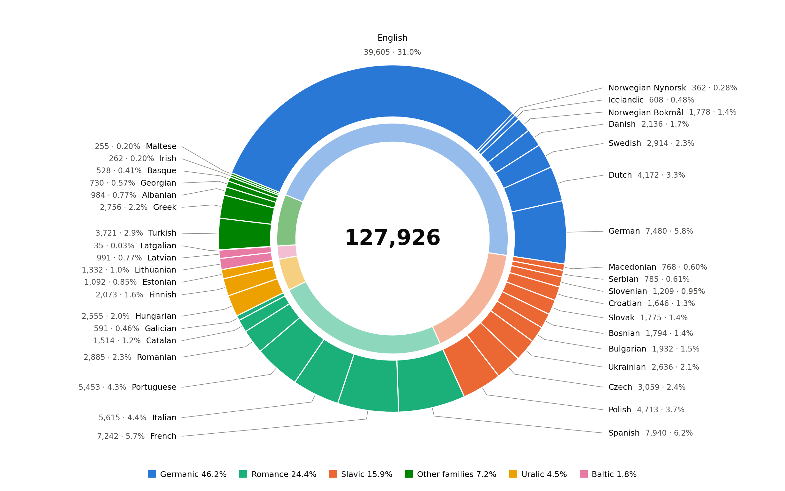
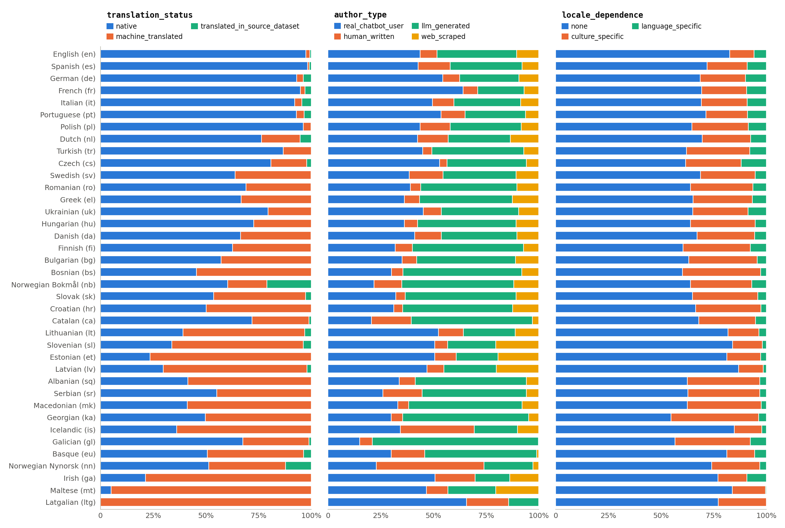
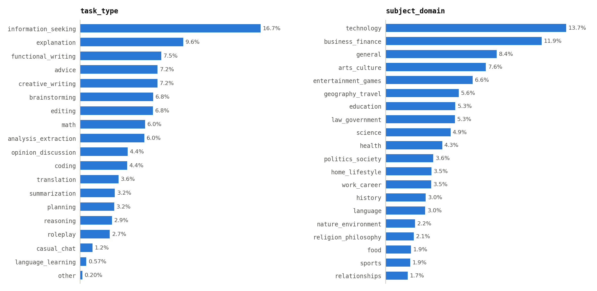
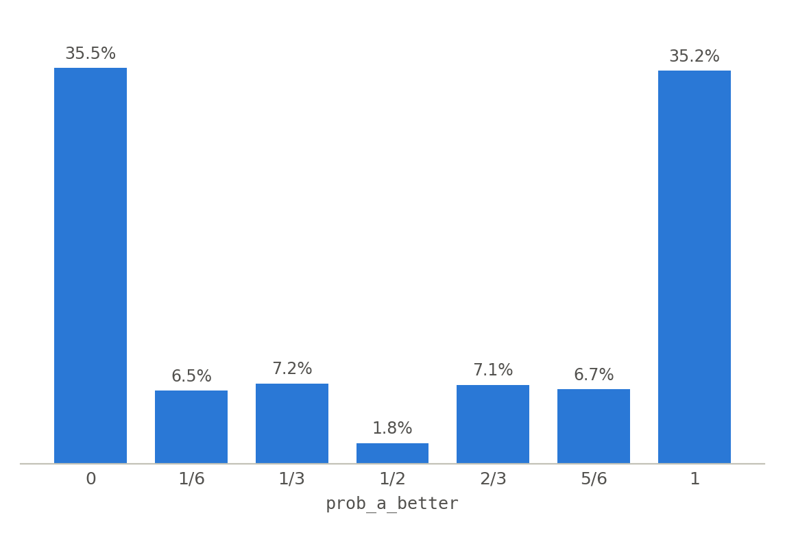
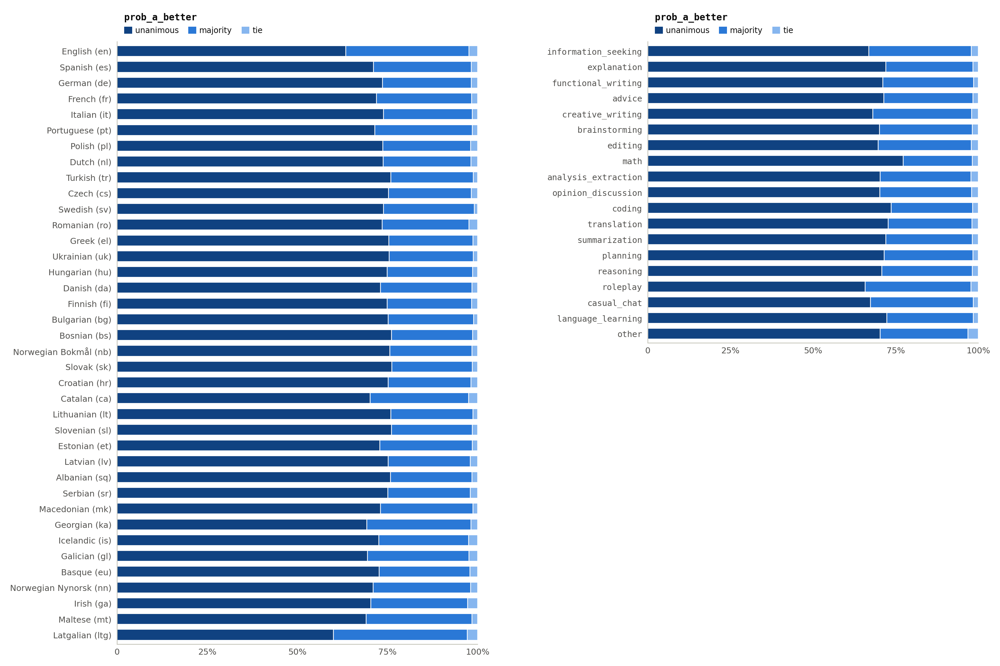
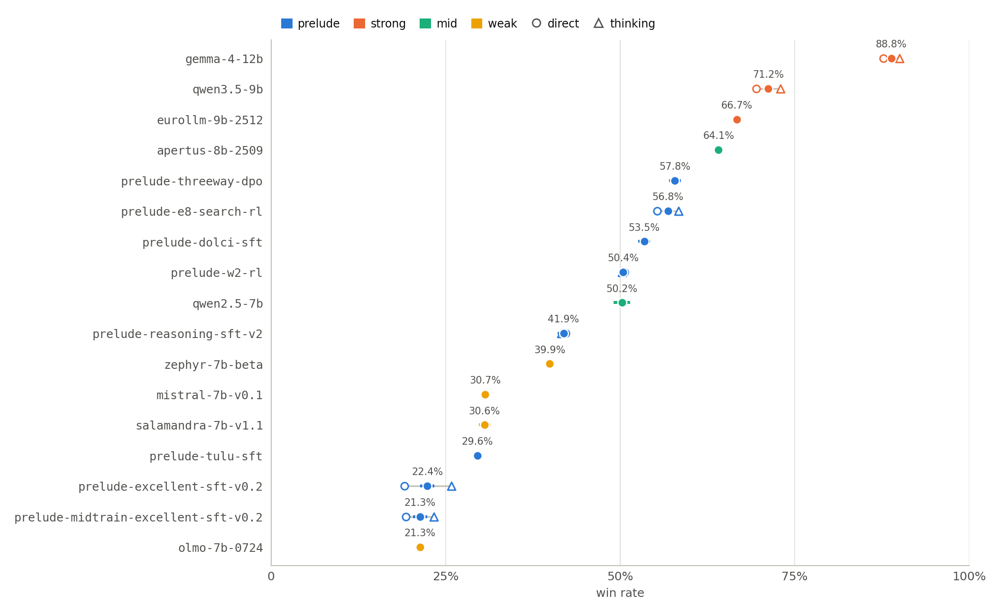
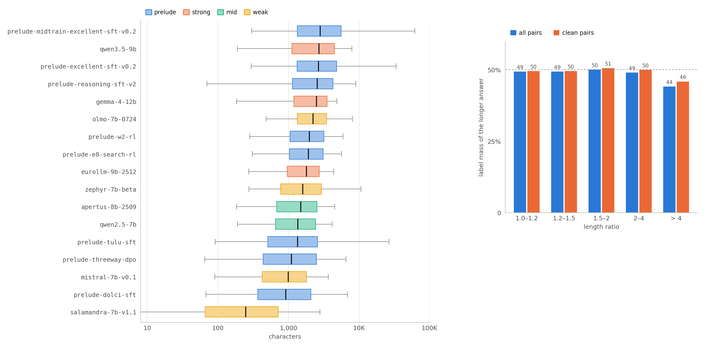

# Prelude reward modelling

[Beware, this repository has been fully generated with Claude Code (Opus 5.5 and Fable 5.1). The output artifacts have been manually checked, but not the code itself.]

A preference dataset for training a reward model for [OpenEuroLLM Prelude 9B](https://huggingface.co/openeurollm):
128,000 prompts in 38 European languages, two answers to each from a pool of 17 models, and a soft preference
label from a panel of open LLM judges. It is released at
[huggingface.co/datasets/openeurollm/prelude-reward-modeling](https://huggingface.co/datasets/openeurollm/prelude-reward-modeling)
as two files: `preferences.jsonl`, the default configuration, with the prompts, answers and labels, and
`prompts.jsonl` with the prompts alone. Their format is in [section 4](#4-files-and-format).

The code is one directory per stage, each with a README that documents every step and decision:
[`collect-prompts/`](collect-prompts/), [`collect-responses/`](collect-responses/) and
[`collect-preferences/`](collect-preferences/). Everything ran on LUMI (AMD MI250X) with open models; Claude
was used only to translate most of the Icelandic and Irish prompts and as the evaluation reference for the judges.
The dataset card on the Hub, `DATASET_CARD.md`, is generated from this README by `collect-preferences/build_card.py`. <!-- github-only -->

## 1. Prompts

**Languages.** The 38 languages are those of Prelude's training mix, whose 41 codes include a second code for
Latvian, Estonian and Albanian (`lvs`, `ekk`, `als`). They get quotas proportional to the square root of their HPLT 3.0 document counts: a
compromise between proportional (English would take 81%) and uniform (Maltese would equal German). English has
31%, the smallest language, Latgalian, 35 prompts.


*Prompts per language and language family.*

**Language is independent of content.** Every language receives the same distribution over content strata
(purpose × task × subject domain × number of turns), so French is not mostly education questions and Latvian
not mostly synthetic prompts. The mix is 80% general prompts, 10% instruction following with explicit
constraints (2,604 with IFEval-style verifiers) and 10% safety (5% requests to refuse, half of them
jailbreaks; 5% sensitive but legitimate); 22% are multi-turn. Task and domain follow a √-smoothed
distribution of what real users ask, with a floor per category. Only the origin mix is not matched: languages
without enough real-user prompts use their natively written synthetic ones instead of translations.

**Sources.** 43 public datasets, with each underlying prompt used once: logs of real chatbot use (WildChat, the
LMArena and compar:IA arenas, HelpSteer3, PolyGuardMix; 44% of the set), LLM-generated prompts
(EuroMultiSynth, Dolci, ALIA; 37%), web questions (every_prompt; 10%) and human-written ones (OASST2 and
others; 10%). Each row carries its source's licence; sources without redistribution rights (LMSYS-Chat) were
excluded. From a pool of 859k extracted items, candidates were language-identified (OpenLID-v3),
deduplicated, capped per user, labelled by Gemma 4 31B (task, domain, safety, complexity, locale dependence,
constraints, quality flags) and embedded with bge-m3 for near-duplicate removal, diversity across clusters and
cross-lingual decontamination against 31 held-out benchmarks (RewardBench 1 and 2, M-RewardBench, RM-Bench,
Arena-Hard and m-ArenaHard, MT-Bench and AlpacaEval in their multilingual versions, the IFEval family, XSTest,
HarmBench, M-ALERT and others). Template families, prompts that share most of their first turn, are capped at
two rows each.

**Translation fills the gaps.** Slots that no native prompt can fill (15% of the set, mostly in the small
languages) take a donor prompt of the same stratum, usually English, translated as a whole conversation in
user-style phrasing. The translator was chosen per language on FLORES+ and on blind reads of real prompts:
Gemma 4 31B by default, TildeOpen-30B for Lithuanian, Estonian, Slovenian and Hungarian, TranslateGemma for
Basque, Maltese and Latvian, Latgalian through a Latvian pivot, and Icelandic and Irish mostly translated by
Claude after every MT system stayed weak (SalamandraTA-7B for the rows kept out of manual translation: harmful
requests, verifier constraints, code). Every translation passed language, structure and literal-content
checks; failures were refilled over 21 rounds. Prompts about a language itself are never translated.


*Per language: how the prompts got there, who wrote them, and how locale-dependent they are.*


*Task type and subject domain of the final user request, as labelled by Gemma 4 31B.*

## 2. Responses

**Two answers per prompt from 17 models**, each drawn independently (6.9% of the prompts have both answers from
the same model). The pool spans the quality range a reward model has to rank: eight Prelude 9B checkpoints (the
policies the reward model is for: w2-RL, e8-search-RL, three-way DPO, Dolci SFT, two Excellent SFT v0.2, a
reasoning SFT and the first Tulu SFT), three strong recent ~9B models (Qwen3.5-9B, Gemma 4 12B, EuroLLM-9B),
two middling ones (Qwen2.5-7B, Apertus-8B) and four old 7B models (Mistral v0.1, Zephyr, OLMo, Salamandra) that
produce wrong-language answers, loops and word salad. Models whose answers are word salad in more than 10% or
25% of a smoke test are drawn half or a quarter as often.

**Sampling.** Temperature 1.0 and nothing else, for every model: bad answers are wanted. The seven models with
a thinking mode use it on half of their prompts, with the reasoning stored apart from the answer. Budgets are
16,384 new tokens (32,768 with thinking); answers cut at the first pass's smaller budget were continued from
where they stopped rather than resampled, so that long answers were not replaced by short ones (1.8% still end
at a limit). Three chat templates inject their own model identity as a system prompt; they got the same prompt
naming Prelude instead. No other prompt was added, and no answer was edited or filtered.

## 3. Preferences

**One overall preference, soft labels from binary votes.** Human and judge ratings of helpfulness,
correctness, coherence and style are nearly collinear, so the judges give one verdict; the aspects that stand
apart (harm, language, constraint compliance, length) are measured by their own instruments. Every pair is
judged by three judges in both presentation orders; the label is the share of the six votes for an answer, so
a judge that changes its mind with the order contributes 0.5. Graded verdicts and verdict-token probabilities
were not used: the latter saturate at 0 or 1 once the judge has written its analysis.

**Judges.** The candidates were strong open models that fit one LUMI-G node in bf16 and whose licences allow
releasing their outputs; Prelude checkpoints were excluded, being the policies the reward model is for. Three
pilot rounds on 1,008 stratified pairs (200 English, 17–50 per other language, safety and instruction-following
slices boosted), each candidate judging both presentation orders, with Claude Opus 5.5 labels as the reference
(evaluation only, never a training label), settled the prompt, the decoding (thinking on with the vendor's
sampling; greedy decoding made the reasoning models loop) and the judges. The final round:

| Judge | Mode | Consistency | Agreement with Opus | Twice-as-long answer wins (en) | Node-hours per 1k pairs |
|---|---|---|---|---|---|
| Gemma 4 31B | thinking | 93.9% | 94.7% | 49% | 0.50 |
| Qwen3.8-27B | thinking, effort xhigh | 91.3% | 95.7% | 40% | 0.91 |
| gpt-oss-120b | reasoning high | 88.1% | 93.2% | 41% | 0.49 |
| gpt-oss-120b | reasoning medium | 86.8% | 90.2% | 41% | 0.21 |
| Qwen3.5-122B-A10B | thinking | 89.8% | 94.8% | 47% | 1.03 |
| Qwen3.5-27B | thinking | 90.0% | 94.8% | 52% | 0.58 |
| Command A+ 05-2026 | thinking (stopped after 103 pairs) | 96.1% | 94.5% | – | ≈2.2 |
| Mistral Small 4 119B | reasoning high | 84.2% | 89.4% | 51% | 0.87 |
| Mistral Large 2411 | no thinking mode, greedy | 84.8% | 89.6% | 50% | 0.84 |
| GLM-4.5-Air | thinking | 86.6% | 88.0% | 55% | 0.65 |
| Apertus 1.5 70B | thinking | 82.6% | 83.3% | 60% | 1.21 |
| Claude Opus 5.5 (reference) | adaptive thinking, effort high | 95.3% | – | 43% | – |

Consistency: the same winner in both presentation orders. Agreement: with Opus, on the pairs where both are
consistent. Twice-as-long: the implied win rate of an answer twice as long as an equally good one, on clean
English pairs (one standard error about 4 points). Node-hours: one LUMI-G node of 8 MI250X GCDs.

**The pool** is Gemma 4 31B, Qwen3.8-27B and gpt-oss-120b at reasoning high: the best agreement per node-hour,
from three model families, so that most pairs can have all three. A judge never grades an answer from its own
family (Gemma 4 12B, the two Qwen responders, Mistral 7B and Zephyr are responders); its place goes to the
first eligible substitute in the order Qwen3.5-122B-A10B, Mistral Small 4, GLM-4.5-Air, and a pair whose six
votes split evenly gets one more judge from the same list. With this assignment the pilot's labels agree with
Opus on 94.3%. Not used: Qwen3.5-27B (below Qwen3.8 and of the same family), gpt-oss at medium effort, Command
A+ (about four times Gemma's cost), Mistral Large 2411 (no thinking mode, the lowest consistency, 22 pilot
prompts beyond its 32k context, and a research-only licence on its outputs) and Apertus 1.5 70B.

**What a judge sees** is the conversation and the two answers verbatim, nothing else: no model names, no
reasoning, no metadata. The prompt asks it to work out what the user needs, then to assess both answers on
criteria in order of priority, where a serious failure on a higher one outweighs any advantage on a lower one:
harm, usability, language, correctness, instruction following, helpfulness and concision (of two equally good
answers the shorter wins). It answers with a JSON object whose analysis precedes a forced verdict.

**Post-processing.** Two rules override the votes: an answer that leaks `<think>` tags into its text loses
(940 pairs), and in pairs too long for any judge, an answer that ran to the token limit and is over four times
longer than a normal one loses (99 pairs; every such answer was read and is a loop or word salad). 70 pairs no
judge could read stay unlabelled and are not released. 778,036 votes in all, about 260 node-hours.


*The label `prob_a_better`: 70.5% of the vote-labelled pairs are unanimous, 1.8% tie.*


*Agreement among the judges per language and per task type.*

**Properties.** On the pilot pairs the labels agree with Opus on 94.7% (an even split counting half); this is
in-sample, as the pilot also chose the prompt and the pool. The labels carry no length preference: the longer
answer receives 49–51% of the label mass in every length-ratio band up to 4×, and 44% beyond, where the long
answers are mostly degenerate. Models rank as expected, with Gemma 4 12B winning 89% of its pairs and the
Prelude checkpoints between 21% and 58%; thinking beats direct answering by 2–7 points for the models that
benefit from it.


*Win rate per responder (the label mass its answers receive), with the thinking / direct split.*


*Answer length per model, and the label mass of the longer answer by length ratio.*

## 4. Files and format

| File | Rows | Content |
|---|---|---|
| `preferences.jsonl` (default) | 127,926 | prompt, two answers, label and votes: everything below |
| `prompts.jsonl` | 128,000 | the prompt fields only, for all prompts (74 have no labelled pair: both answers empty, or too long for every judge) |

One JSON object per line, UTF-8, both files in the same random order. A row of `preferences.jsonl`:

```jsonc
{
  "messages": [{"role": "user", "content": "..."}],   // the conversation; it ends with the user turn to answer,
                                                      // earlier turns (system, assistant) are context
  "response_a": {
    "content": "...",                      // the answer as the model wrote it; empty if it wrote nothing
    "reasoning": null,                     // its hidden thinking in "thinking" mode, else null; never shown to the judges
    "model": "google/gemma-4-12B-it",      // Hugging Face id, with "model_revision": the commit of the weights
    "model_revision": "43c9d014b231474fa7212dbb48a762566c2b255d",
    "mode": "direct",                      // or "thinking"
    "finish_reason": "stop",               // "length": cut at the token budget
    "detected_language": "lt",             // OpenLID-v3 on the answer, with "detected_language_confidence";
    "detected_language_confidence": 0.99   // null for empty or very short answers
  },
  "response_b": { ... },                   // the same fields; which answer is "a" carries no information
  "preference": {
    "prob_a_better": 0.833,                // THE LABEL: probability that response_a is the better answer, in [0, 1];
                                           // the share of the votes for a, or exactly 0 / 1 where a rule applied
    "rule": null,                          // "think_tag" or "too_long" where a rule set the label, else null
    "votes": [                             // every valid vote, both presentation orders of each judge (6, or 8 after a tie-break)
      {"judge": "google/gemma-4-31B-it",   // Hugging Face id of the judge
       "shown_first": "a",                 // which answer the judge saw as "Response A"
       "prefers": "b",                     // its verdict, mapped to a / b
       "short_rationale": "...",           // its one-paragraph comparison
       "full_rationale": "Request: ...\n\nResponse A: ...\n\nResponse B: ...\n\nComparison: ...\n\nVerdict: B"}
    ]                                      // rationales are in the judge's own frame: "Response A" is the answer named by shown_first
  },
  "id": "mlp128k-083978",                  // the prompt fields, as in prompts.jsonl:
  "language": "lt",
  "translation_status": "native",          // native / machine_translated / translated_in_source_dataset
  "translation_model": null,               // for machine-translated rows: the translator, and
  "translated_from_language": null,        //   the language of the original prompt
  "category": "general",                   // general / instruction_following / safety_benign / safety_harmful
  "task_type": "brainstorming",            // 19 task types, e.g. information_seeking, coding, editing
  "subject_domain": "work_career",         // 20 domains, "general" if none applies
  "author_type": "real_chatbot_user",      // real_chatbot_user / human_written / llm_generated / web_scraped
  "safety_label": "none",                  // none / sensitive_benign / harmful / jailbreak
  "locale_dependence": "none",             // none / culture_specific / language_specific
  "complexity": "simple",                  // simple / moderate / hard
  "explicit_constraint_types": ["length"], // kinds of checkable requirements the user states; may be empty
  "request_summary": "...",                // one English sentence saying what the user wants
  "verifiable_instructions": null,         // for 2,604 rows: {"instruction_ids": [...], "kwargs": "..."}, IFEval-style;
                                           // kwargs is a JSON string: a list with one object or null per instruction id
  "source": {"dataset": "lmarena-ai/arena-human-preference-100k", "subset": "default",
             "item_id": "...", "license": "cc-by-4.0"}
}
```

`task_type`, `subject_domain`, `safety_label`, `locale_dependence`, `complexity`, `explicit_constraint_types`
and `request_summary` were predicted by Gemma 4 31B in a single pass over the prompt as written in its source
(so for translated rows they describe the original); `category` and `author_type` follow from the source.
`language` is ISO 639-1, or 639-3 where there is none (`ltg`). A judge's rationale may be null for the 23
votes whose JSON could not be parsed (their verdict was recovered from the text) and `short_rationale` for
432 more whose comparison field was empty.
